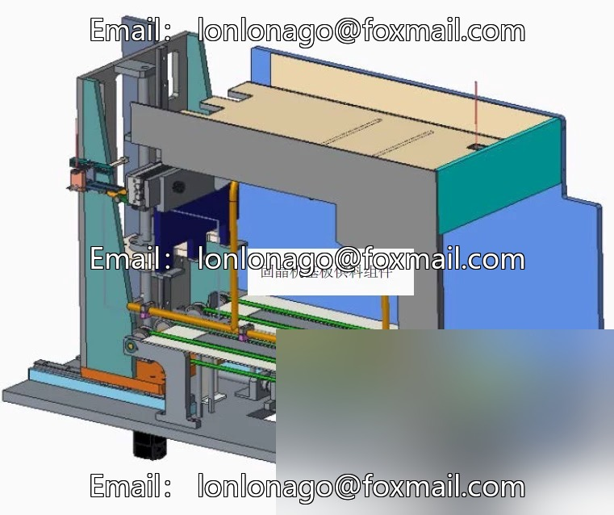

# Solid crystallization machine substrate supply component

## Body

Solid crystal machine substrate supply component

It has detail, and thus has great reference value

CREO3. 0 Parts and assemblies (asm and prt files)
Editable

The ones that need to be directly taken can be left with email, no reply for detailed consultation, thank you.

Products not sold are non-refundable, technical support is not provided

The product is a solid-crystal machine base supply component; it includes creo3.0 part and assembly files (asm and prt), is editable, requires an email for detailed inquiries, and is non-refundable with no technical support provided.

<!-- AI_ENRICHED -->

## Images

## Payment

Here is a pay link on Stripe ( https://buy.stripe.com/3cs8yP7sY87d0vu9AB ). Please contact me lonlonago@foxmail.com after funding $89, and I will send you a complete data files , thank you!

